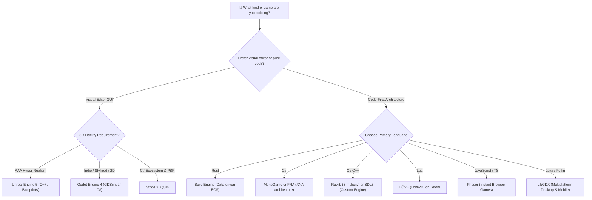

# 🎮 Awesome Game Development Libraries &amp; Engines

**A comprehensive, curated directory of top game engines, cross-platform graphics libraries, rendering backends, and game programming frameworks.**

*Empowering indie game creators, graphics engineers, studio architects, and engine tinkerers with code-first frameworks, low-level APIs, and production-tested game tech.*

---

## 📑 Table of Contents

- [🌟 Introduction &amp; SEO Overview](#-introduction--seo-overview)
- [📊 Sector Overview &amp; Market Dynamics](#-sector-overview--market-dynamics)
- [💼 Commercial &amp; SaaS Game Platforms](#-commercial--saas-game-platforms)
- [🔓 Open-Source Game Engines &amp; Libraries](#-open-source-game-engines--libraries)
  - [🏆 Star-Ranked Open-Source Ecosystem](#-star-ranked-open-source-ecosystem)
  - [🔍 Deep Dives by Architectural Category](#-deep-dives-by-architectural-category)
- [🛠️ Decision Matrix: How to Choose](#️-decision-matrix-how-to-choose)
- [🤝 How to Contribute](#-how-to-contribute)
- [💖 Support &amp; Sponsoring](#-support--sponsoring)
- [📈 Star History](#--star-history)
- [⚖️ Disclaimer &amp; Platform Risk Notice](#️-disclaimer--platform-risk-notice)

---

## 🌟 Introduction &amp; SEO Overview

Whether you are architecting a custom AAA rendering pipeline with **DirectX 12**, **Vulkan**, or **Metal**, shipping a multiplatform 2D indie title on Nintendo Switch, or writing lightweight browser games via **WebGPU** and **WebAssembly (WASM)**, selecting the right software foundation is the most critical technical choice in game production.

This repository catalogs industry-leading commercial platforms and actively maintained open-source libraries across **C++**, **Rust**, **C#**, **C**, **JavaScript/TypeScript**, **Java**, and **Lua**. From minimalist windowing toolkits and low-level graphics abstractions to full-featured visual editors with Entity Component Systems (ECS), discover the best tool for your game architecture.

---

## 📊 Sector Overview &amp; Market Dynamics

- **Estimated Market Size**: The global game engine and game development software market reached approximately **$4.8 Billion** and is projected to expand to **$10.5+ Billion** (growing at a compound annual growth rate of ~**13.5%**), propelled by the rise of indie studio launches, cross-platform mobile gaming, virtual production in film, and real-time 3D simulation.
- **Market Concentration &amp; Fragmentation**: The sector demonstrates a **bimodal concentration**:
  - *High Concentration in Enterprise 3D*: The commercial AAA tier is highly concentrated—a near-duopoly dominated by **Epic Games (Unreal Engine)** and **Unity Technologies**, which capture the overwhelming majority of commercial studio seats and real-time cinematic productions.
  - *High Fragmentation in Indie &amp; Code-First Frameworks*: The 2D, indie, and code-first segments are moderately to highly fragmented. Developer backlash over proprietary runtime fee changes has accelerated mass migration toward MIT/open-source solutions like **Godot Engine**, **Bevy**, **Raylib**, and **SDL**. Studios increasingly favor architectural sovereignty, zero licensing lock-in, and full source code inspectability.

---

## 💼 Commercial &amp; SaaS Game Platforms

The following table benchmarks notable commercial game engines and hosted platforms, sorted by **Company Size (Valuation / Revenue) Descending**.

| 🏢 Platform / Product | 📈 Company Size (Valuation / Revenue) | 🏷️ Pricing (Starting Tier) | 🎁 Free Tier Limit | 🎯 Primary Focus &amp; Target Ecosystem |
| :--- | :--- | :--- | :--- | :--- |
| [**Roblox Studio**](https://create.roblox.com/) | **~$32.0 Billion** valuation / **~$3.6B** annual revenue | Free engine and hosting; monetized via **70/30 developer split** (Developers cash out via DevEx at $0.0035/Robux) | **Free forever** for all creators with unlimited hosted multiplayer cloud servers and cloud storage | Metaverse, multiplayer social experiences, user-generated content (UGC), and Lua scripting |
| [**Unreal Engine**](https://www.unrealengine.com/) | **~$31.5 Billion** valuation / **~$5.8B** annual revenue | **5% royalty** on gross game revenues exceeding **$1,000,000 USD**; or **$1,850/seat/year** for non-gaming commercial seats | **Free forever** until project lifetime gross revenue surpasses **$1,000,000 USD**; includes full source code access and Unreal Editor | AAA photorealistic 3D, Nanite/Lumen rendering, C++, visual Blueprints, PC, consoles, and virtual production |
| [**Unity**](https://unity.com/) | **~$8.5 Billion** market cap / **~$2.1B** annual revenue | **Unity Pro** starts at **$2,040/seat/year** (or **$185/month** on annual plan); Enterprise starts at **$4,000+/seat/year** | **Unity Personal** is **free forever** for creators/studios with revenue and funding **under $200,000 USD** in the past 12 months (requires "Made with Unity" splash) | 2D/3D cross-platform mobile, indie PC, console games, VR/AR, and comprehensive Asset Store ecosystem |
| [**GameMaker**](https://gamemaker.io/) | **~$1.6 Billion** parent market cap (Opera) / **~$450M** annual revenue | **GameMaker Professional** starts at **$99.99 one-time payment** for commercial desktop, web, and mobile release; Enterprise console tier at **$79.99/month** | **Free forever** for learning, prototyping, and non-commercial publishing to GX.games web portal | Fast 2D game prototyping, visual GML / code scripting, indie hits (*Undertale*, *Hotline Miami*) |
| [**Construct 3**](https://www.construct.net/) | **~$30.0 Million** valuation / **~$8.0M** annual revenue | **Personal plan** starts at **$22.99/month** (or **$129.99/year**); Business tier starts at **$45.99/month** (or **$459.99/year**) | **Free edition** is **free forever in-browser**, strictly limited to a maximum of **50 events**, **2 layers**, and non-commercial use | No-code / block-based 2D HTML5 game development, classroom education, and rapid web prototyping |

---

## 🔓 Open-Source Game Engines &amp; Libraries

Open-source game frameworks provide total code autonomy, eliminate runtime fee risks, and allow teams to inspect, debug, and optimize every cycle of their render loops.

### 🏆 Star-Ranked Open-Source Ecosystem

The repositories below are **strictly sorted descending by GitHub Star Count** as of October 2026.

| 🎖️ Rank | 📦 Repository | 🌟 Stars Badge | 💻 Language | 🚀 Architectural Role | 📄 License |
| :---: | :--- | :--- | :---: | :--- | :---: |
| 1 | [**Godot Engine**](https://github.com/godotengine/godot) |  | C++ | Full Feature 2D/3D Game Engine with Visual Editor | MIT |
| 2 | [**Bevy**](https://github.com/bevyengine/bevy) |  | Rust | Data-Driven ECS Engine with Modern WGPU Renderer | MIT / Apache-2.0 |
| 3 | [**Phaser**](https://github.com/phaserjs/phaser) |  | JavaScript | Fast 2D Framework for HTML5, Canvas &amp; WebGL Browsers | MIT |
| 4 | [**Raylib**](https://github.com/raysan5/raylib) |  | C | Minimalist, Hardware-Accelerated C Game Programming Library | Zlib |
| 5 | [**LibGDX**](https://github.com/libgdx/libgdx) |  | Java | Battle-Tested Cross-Platform 2D/3D Framework | Apache-2.0 |
| 6 | [**Cocos2d-x**](https://github.com/cocos2d/cocos2d-x) |  | C++ | Mature 2D Multiplatform Framework for Mobile and Desktop | MIT |
| 7 | [**bgfx**](https://github.com/bkaradzic/bgfx) |  | C++ | Cross-Platform, Graphics API Agnostic Rendering Library | BSD-2-Clause |
| 8 | [**SDL (Simple DirectMedia Layer)**](https://github.com/libsdl-org/SDL) |  | C | Foundational Hardware Windowing, Audio, Input &amp; GPU API | Zlib |
| 9 | [**MonoGame**](https://github.com/MonoGame/MonoGame) |  | C# | Industry Standard C# Game Framework (XNA 4.0 Successor) | MIT |
| 10 | [**Open 3D Engine (O3DE)**](https://github.com/o3de/o3de) |  | C++ | AAA Modular Multiplatform 3D Engine (Amazon Lumberyard Evolution) | Apache-2.0 |
| 11 | [**LÖVE (Love2D)**](https://github.com/love2d/love) |  | C++ / Lua | Elegant, Lightweight 2D Framework for Rapid Lua Development | Zlib |
| 12 | [**Stride 3D**](https://github.com/stride3d/stride) |  | C# | Modern C# 3D Game Engine with PBR Renderer and Editor | MIT |
| 13 | [**Defold**](https://github.com/defold/defold) |  | C++ / Lua | High-Performance, Turnkey 2D Engine with Tiny Binary Footprint | Defold License |
| 14 | [**FNA**](https://github.com/FNA-XNA/FNA) |  | C# | High-Fidelity Accuracy-Focused XNA 4.0 Reimplementation | MIT |
| 15 | [**Allegro 5**](https://github.com/liballeg/allegro5) |  | C | Veteran Multimedia, Audio, and 2D Primitives Library | Zlib |
| 16 | [**Axmol Engine**](https://github.com/axmolengine/axmol) |  | C++ | Active Multi-Platform 2D/3D Fork of Cocos2d-x with Modern CMake &amp; WebAssembly | MIT |

---

### 🔍 Deep Dives by Architectural Category

#### 1. Full-Featured Open-Source Engines (With Editors)
- 🤖 **[Godot Engine](https://github.com/godotengine/godot)**   
  *The undisputed flagship of community-driven game engines.* Godot features dedicated 2D and 3D pipelines, node-based scene architecture, built-in scripting via **GDScript** and **C# (.NET)**, and complete zero-royalty MIT licensing. Powers hits like *Brotato*, *Dome Keeper*, and *Cassette Beasts*.
- 💎 **[Stride 3D](https://github.com/stride3d/stride)**   
  *The modern open C# alternative to commercial 3D engines.* Features a full graphical editor, realistic Physically-Based Rendering (PBR), forward+ lighting, and pure C# code execution without bridge overhead.
- 🏢 **[Open 3D Engine (O3DE)](https://github.com/o3de/o3de)**   
  *Linux Foundation-backed AAA heavyweight.* Built with an Atom physically-based renderer, multi-threading job systems, Lua/Python scripting, and modular "Gems" architecture for simulation and high-end 3D graphics.

#### 2. Code-First Frameworks (No Visual Editor)
- 🦀 **[Bevy](https://github.com/bevyengine/bevy)**   
  *Next-generation ergonomic ECS engine in Rust.* Leverages an ultra-fast archetypal Entity Component System, cross-platform WebGPU rendering via `wgpu`, fast incremental compilation, and modular Rust plugins.
- ⚡ **[MonoGame](https://github.com/MonoGame/MonoGame)**   
  *The battle-tested indie legend.* Powered blockbuster commercial titles including *Celeste*, *Stardew Valley*, and *Hades*. Provides high-performance 2D/3D sprite batches, audio, and gamepad abstractions across Windows, macOS, Linux, iOS, Android, and consoles.
- 🎯 **[FNA](https://github.com/FNA-XNA/FNA)**   
  *Accuracy-first XNA preservation.* Focuses on 100% exact XNA 4.0 specification compliance, utilizing SDL and modern native backends to ensure legacy and modern .NET games run flawlessly.
- 💖 **[LÖVE (Love2D)](https://github.com/love2d/love)**   
  *Beloved 2D prototyping engine using Lua.* Offers straightforward drawing, audio, and physics primitives via Box2D. Exceptional for 48-hour game jams, hobbyists, and shipping indie cult hits (*Balatro*).
- ☕ **[LibGDX](https://github.com/libgdx/libgdx)**   
  *Enterprise Java multiplatform workhorse.* Directly targets desktop (LWJGL), Android, iOS (via RoboVM), and WebGL with unified Java/Kotlin codebases. Proven by *Slay the Spire*.

#### 3. Low-Level Multimedia &amp; Hardware Abstraction
- 🧱 **[SDL (Simple DirectMedia Layer)](https://github.com/libsdl-org/SDL)**   
  *The backbone of PC and console gaming.* SDL3 introduces modern GPU rendering APIs, high-DPI handling, native storage abstractions, and universal gamepad mapping. Used under the hood by Valve's Steam, emulators, and countless game runtimes.
- 🎨 **[bgfx](https://github.com/bkaradzic/bgfx)**   
  *Cross-platform rendering pipeline abstraction.* Supports Vulkan, DirectX 11/12, Metal, OpenGL, and WebGPU with a unified shader language (`shaderc`). Ideal for programmers writing their own custom engine.
- 🎒 **[Raylib](https://github.com/raysan5/raylib)**   
  *Minimalist C library with zero third-party dependencies.* Offers immediate-mode OpenGL rendering, 3D model loaders, sound management, and bindings to 60+ programming languages.

#### 4. Web &amp; Mobile Specialists
- 🌐 **[Phaser](https://github.com/phaserjs/phaser)**   
  *The monarch of browser-based 2D HTML5 games.* Features dual WebGL and Canvas renderers, Arcade/Matter.js physics, tilemap support, and audio sprites tailored for instant web play and mobile browsers.
- 📱 **[Defold](https://github.com/defold/defold)**   
  *Lightweight mobile powerhouse.* Produces sub-5MB binary footprints, zero runtime allocations, Lua scripting, and lightning-fast builds targeting iOS, Android, HTML5, and consoles.
- 🔄 **[Axmol Engine](https://github.com/axmolengine/axmol)**   
  *The revitalized modern C++ fork of Cocos2d-x.* Actively updated with WebAssembly support, Metal/Vulkan backends, CMake build pipelines, and modernized C++20 code conventions.

---

## 🛠️ Decision Matrix: How to Choose

---

## 🤝 How to Contribute

Contributions are warmly welcomed! Help keep this ecosystem guide updated and comprehensive:

1. 🍴 **Fork the Repository** on GitHub.
2. 🌿 **Create a Feature Branch**: `git checkout -b feature/add-new-library`.
3. 📝 **Add or Update Entries**: Ensure your entries adhere to the table structure, link directly to GitHub repositories or official sites, and provide concrete pricing/limits.
4. 🚀 **Submit a Pull Request** with a concise description of your changes.

---

## 💖 Support &amp; Sponsoring

Thank you for exploring and using this game development directory! If you find this curated resource valuable for your projects or research, please consider supporting:

- ⭐ **Star this repository** on GitHub to increase its visibility for fellow game creators.
- 🍴 **Fork and share** with your developer teams, game jam communities, and indie circles.
- ☕ **Buy a coffee / Sponsor**: Support ongoing maintenance and ecosystem curation via the [GitHub Sponsors Dashboard](https://github.com/sponsors/ishandutta2007). Every contribution is deeply appreciated!

---

##  Star History

---

## ⚖️ Disclaimer &amp; Platform Risk Notice

- This repository is a community-maintained curated index, not an endorsement of any commercial platform.
- **Platform &amp; Pricing Risk**: Proprietary engines can introduce retroactive fee restructuring, price hikes, or editor monetization changes. Teams with multi-year production schedules should carefully weigh open-source frameworks (MIT, Zlib, Apache-2.0) against commercial vendor lock-in.
- **Maintenance Health**: Always inspect GitHub commit velocity, open issue resolution rates, and release frequency when adopting third-party dependencies for commercial titles.

---

  Built with ❤️ for the global game development community. Star ⭐ this repo to help fellow game creators find their ideal engine!

